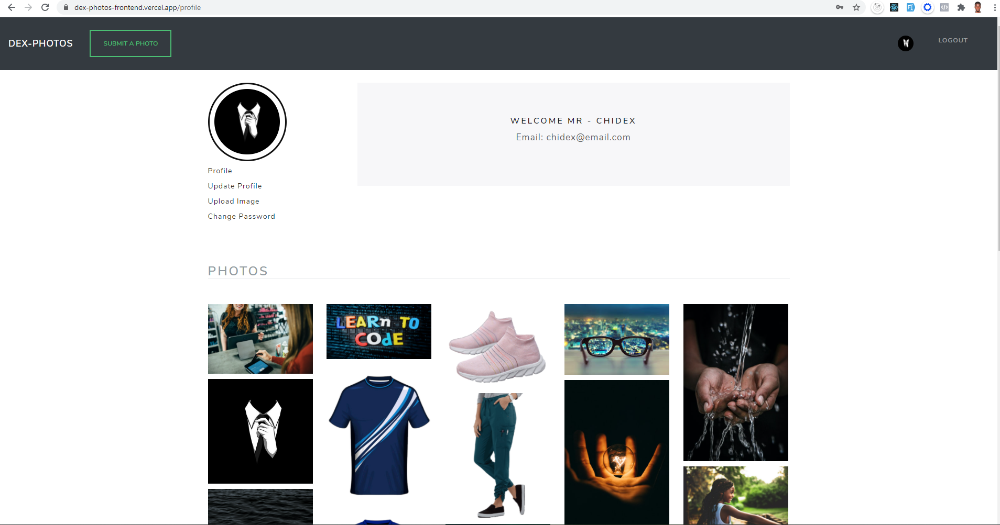

# PicPik

A Photo Gallary app where users can sigmnup, download and upload Images.

```
MERN APP - Idea from unsplash
```

## Built With

- Node.js
- Mongo DB
- Express
- Git
- Json Web Token
- Postman
- React JS
- Next JS
- Bootstrap
- Redux

## Features

- Image uploads
- User signup and signin
- Authorization and Authentication etc.

## OTHERS

converted app from React to Next

## Running and deploying

The Next.js app in `frontend/` serves both the website and its API. MongoDB and Cloudinary credentials are read only by server-side API routes.

Prerequisites: Node.js, Yarn, MongoDB (local or Atlas), and a Cloudinary account for image uploads.

1. Install the application dependencies:

   ```sh
   cd frontend
   yarn install
   ```

2. Copy `frontend/.env.example` to `frontend/.env.local` and set your MongoDB URI, a private `SECRET_KEY`, and Cloudinary credentials. Set the admin seed values if you want an initial admin account. Never prefix these secrets with `NEXT_PUBLIC_`.

3. Run the entire application from `frontend/` with `yarn dev`, or from the repository root with `yarn dev`. Open `http://localhost:3000`.

4. For deployment, select `frontend/` as the project root and configure the same environment variables in the hosting provider. Build with `yarn build` and serve with `yarn start`.

## Clone this project

    $ git clone https://github.com/mr-chidex/PicPik.git
    $ cd PicPik

## Preview




## Show your support

Give a ⭐️ if you like this project!

## Copyright

Copyright (c) mr-chidex
