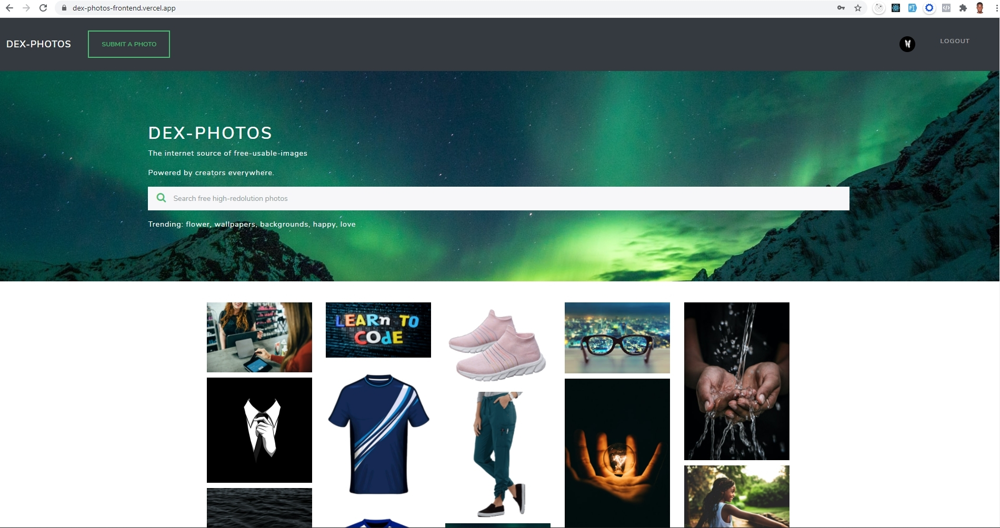

# PicPik

A Photo Gallary app where users can sigmnup, download and upload Images.

```
MERN APP - Idea from unsplash
```

## Built With

- Node.js
- Mongo DB
- Express
- Git
- Json Web Token
- Postman
- React JS
- Next JS
- Bootstrap
- Redux

## Features

- Image uploads
- User signup and signin
- Authorization and Authentication etc.

## OTHERS

converted app from React to Next

## Running locally

Prerequisites: Node.js, Yarn, MongoDB (local or Atlas), and a Cloudinary account for image uploads.

1. Install the backend dependencies from the repository root:

   ```sh
   yarn install
   ```

2. Copy `.env.example` to `.env` in the repository root. Set `DEX_PHOTOS` to your MongoDB connection string and `SECRET_KEY` to a private random value. Set the Cloudinary credentials to enable uploads. The first run creates the configured admin account and a test account if the database is empty.

3. Start the backend from the repository root:

   ```sh
   yarn dev
   ```

   The API listens on `http://localhost:5000`.

4. In a second terminal, install and start the frontend:

   ```sh
   cd frontend
   yarn install
   yarn dev
   ```

   Open `http://localhost:3000`. The frontend uses `http://localhost:5000/api/v1` by default; set `NEXT_PUBLIC_BASE_URL` before starting/building it to use another API URL.

## Clone this project

    $ git clone https://github.com/mr-chidex/PicPik.git
    $ cd PicPik

## Preview




## Show your support

Give a ⭐️ if you like this project!

## Copyright

Copyright (c) mr-chidex
